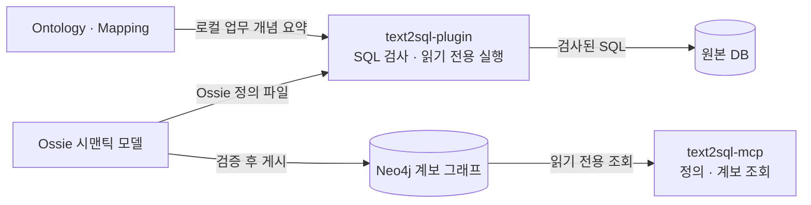

# Text2SQL

자연어 질문을 데이터베이스 조회로 연결하는 프로젝트입니다. SQL 실행 에이전트, 시맨틱 정의, Neo4j 그래프 조회 도구를 독립된 저장소에서 개발하고 이 저장소에서 함께 찾아볼 수 있도록 묶었습니다.

이 저장소의 `plugin/`, `mcp/`, `semantic-definitions/`는 Git Submodule입니다. 각 폴더는 원본 저장소의 특정 커밋을 가리키며 원본 코드와 이력은 해당 저장소에 남습니다.

## 구성 요소

| 폴더 | 원본 저장소 | 역할 |
| --- | --- | --- |
| `plugin/` | [text2sql-plugin](https://github.com/zisu17/text2sql-plugin) | Claude Code와 Codex에서 질문에 맞는 SQL을 검사하고 읽기 전용으로 실행합니다. Ossie 지표 정의를 직접 사용할 수 있습니다. |
| `semantic-definitions/` | [semantic-definitions](https://github.com/zisu17/semantic-definitions) | Ossie 시맨틱 모델, 업무 개념, 매핑을 관리합니다. Ossie 정의와 물리 컬럼의 계보를 Neo4j에 게시합니다. |
| `mcp/` | [text2sql-mcp](https://github.com/zisu17/text2sql-mcp) | Neo4j에 게시된 현재 정의와 계보를 읽기 전용으로 조회하는 MCP 서버입니다. |

평가셋과 실험 기록은 [text-to-sql-study](https://github.com/zisu17/text-to-sql-study)에 있습니다. 이 저장소는 **Private**이며 접근 권한이 있는 사람만 열 수 있습니다. 공개 저장소를 누구나 복제할 수 있도록 Submodule에는 포함하지 않았습니다.

## 아키텍처



현재 SQL 실행은 플러그인이 Ossie 정의를 직접 읽는 방식입니다. 온톨로지와 매핑은 로컬 `t2s context`의 업무 개념 요약에 쓰이며 그래프에는 게시되지 않습니다. 그래프 MCP는 게시된 Ossie 정의와 계보를 조회하는 별도 도구이며 플러그인의 SQL 실행 경로에 자동으로 연결되지는 않습니다.

## 시작하기

세 공개 저장소를 함께 내려받으려면 다음 명령을 사용합니다.

```bash
git clone --recurse-submodules https://github.com/zisu17/text2sql.git
cd text2sql
```

이미 상위 저장소만 복제했다면 `git submodule update --init --recursive`를 실행합니다. 설치와 실행 환경은 각 컴포넌트의 안내를 따릅니다.

1. [플러그인 설치와 DB 연결](https://github.com/zisu17/text2sql-plugin#readme)
2. [시맨틱 정의 작성과 그래프 게시](https://github.com/zisu17/semantic-definitions#readme)
3. [Neo4j 그래프 MCP 실행](https://github.com/zisu17/text2sql-mcp#readme)

## Submodule 버전 갱신

상위 저장소는 하위 저장소의 최신 상태를 자동으로 따라가지 않습니다. 새 커밋을 반영할 때는 다음 명령으로 참조를 갱신하고 상위 저장소에 커밋합니다.

```bash
git submodule update --remote plugin mcp semantic-definitions
git add plugin mcp semantic-definitions
git commit -m "Update component revisions"
git push
```

각 컴포넌트의 코드 변경은 원본 저장소에서 진행합니다.
