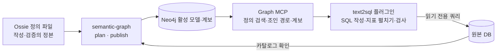

# Text2SQL

자연어 질문을 승인된 시맨틱 지표와 원본 데이터베이스 조회로 연결하는 프로젝트입니다. 이 상위 저장소는 세 독립 저장소를 Git Submodule로 묶고 전체 흐름과 문서의 시작점을 안내합니다.

## 먼저 읽을 곳

| 하려는 일 | 문서 |
| --- | --- |
| 질문으로 지표나 데이터를 조회하기 | [플러그인 설치·사용](https://github.com/zisu17/text2sql-plugin#readme) |
| 지표를 작성·검증하고 그래프에 게시하기 | [시맨틱 정의 저장소](https://github.com/zisu17/semantic-definitions#readme) |
| Graph MCP를 실행·운영하기 | [MCP 서버 저장소](https://github.com/zisu17/text2sql-mcp#readme) |
| 문서 전체에서 필요한 항목 찾기 | 아래 [문서 지도](#문서-지도) |

## 저장소와 데이터 흐름

| 폴더 | 원본 저장소 | 책임 |
| --- | --- | --- |
| `semantic-definitions/` | [semantic-definitions](https://github.com/zisu17/semantic-definitions) | Ossie 모델·업무 개념의 정본을 관리하고 모델과 물리 계보를 Neo4j에 게시 |
| `mcp/` | [text2sql-mcp](https://github.com/zisu17/text2sql-mcp) | Neo4j의 활성 모델을 읽기 전용 MCP 도구로 제공. 정의 검색(BM25), 조인 경로, 계보 조회 |
| `plugin/` | [text2sql-plugin](https://github.com/zisu17/text2sql-plugin) | 승인 지표를 컴파일하고 복합 SQL의 지표(`AGG`)를 펼쳐 원본 DB에서 읽기 전용으로 실행 |



일반 질문에서 지표·필드·연결은 **Graph MCP의 활성 모델**에서 찾습니다(전문 검색 BM25). 같은 뜻의 승인 지표는 `t2s compile --run`으로 계산합니다. 직접 집계와 지표를 섞거나 하위 쿼리가 필요한 경우에는 SQL을 작성하고 지표를 `AGG(별칭.지표)`로 넣습니다. 승인 안 된 연결이나 정의 밖 테이블도 막지 않고 경고와 함께 실행합니다. 로컬 Ossie 파일은 정의를 작성·검증·게시할 때만 사용합니다. 실제 지표 값이나 행을 읽으려면 플러그인에 원본 DB의 읽기 전용 `DATABASE_URL`도 필요합니다. MCP 서버 자체는 원본 DB 행을 조회하지 않습니다. Ontology·Mapping 파일은 정의 저장소에서 관리하며 현재 그래프 게시 범위에는 포함하지 않습니다.

## 문서 지도

| 주제 | 문서 | 내용 |
| --- | --- | --- |
| 사용 | [플러그인 README](https://github.com/zisu17/text2sql-plugin#readme) | 설치, MCP·DB 연결, 스킬, `t2s` 명령 |
| 사용 | [실패 유형](https://github.com/zisu17/text2sql-plugin/blob/main/references/failure-types.md) | 진단 스킬의 오류 분류 |
| 정의 | [시맨틱 정의 README](https://github.com/zisu17/semantic-definitions#readme) | 정의 파일 구조, 검증, 게시 순서 |
| 정의 | [시맨틱 모델 작성 규칙](https://github.com/zisu17/semantic-definitions/blob/main/docs/semantic-model.md) | Ossie 필드·승인 상태·SQL 데이터셋 |
| 정의 | [Olist 평가 지표](https://github.com/zisu17/semantic-definitions/blob/main/docs/evaluation.md) | 예상값과 평가용 지표의 범위 |
| 정의 | [설계 결정 기록](https://github.com/zisu17/semantic-definitions/blob/main/docs/decisions.md) | 파일 구성·SQL 소스·온톨로지 분리의 이유 |
| 그래프 게시 | [GraphDB 계보와 배포](https://github.com/zisu17/semantic-definitions/blob/main/docs/graphdb.md) | 현재 그래프 스키마, `plan`·`publish`, CI |
| MCP | [MCP 서버 README](https://github.com/zisu17/text2sql-mcp#readme) | 서버 시작, 조회 도구, 테스트 |
| MCP | [Graph MCP 조회 계약](https://github.com/zisu17/text2sql-mcp/blob/main/docs/graphdb-mcp-design.md) | 활성 버전, 도구별 입력·출력, 계보 해석 |
| 운영 | [Railway 배포](https://github.com/zisu17/text2sql-mcp/blob/main/docs/railway.md) | 원격 서버 설정과 배포 확인 |
| 설계안·기록 | [계보 그래프 v2 설계안](https://github.com/zisu17/text2sql-mcp/blob/main/docs/semantic-lineage-graph-v2.md) | 현재 게시 스키마와 다른 미구현 설계안 |
| 설계안·기록 | [최초 GraphDB 설계 재현](https://github.com/zisu17/text2sql-mcp/blob/main/graphdb/README.md) | 초기 설계의 별도 재현 코드와 결과 |

평가셋과 실험 기록은 별도 [text-to-sql-study](https://github.com/zisu17/text-to-sql-study) 저장소에 있습니다. 이 저장소는 비공개이며 이곳의 Submodule에는 포함하지 않았습니다.

## 내려받기와 버전 갱신

```bash
git clone --recurse-submodules https://github.com/zisu17/text2sql.git
cd text2sql
```

상위 저장소만 복제했다면 `git submodule update --init --recursive`로 하위 저장소를 받습니다. Submodule은 각 원본 저장소의 **특정 커밋**을 가리킵니다. 원본 저장소에 새 커밋을 푸시해도 상위 저장소의 포인터는 자동으로 바뀌지 않습니다.

원본 저장소의 변경을 먼저 푸시한 뒤 상위 저장소에서 반영할 커밋을 확인하고 포인터를 갱신합니다.

```bash
git submodule update --remote plugin mcp semantic-definitions
git diff --submodule=log
git add plugin mcp semantic-definitions
git commit -m "Update component revisions"
```

상위 저장소의 푸시는 별도 작업입니다. 기존 Submodule 안에 미커밋 변경이 있다면 갱신 전에 처리해야 합니다.
